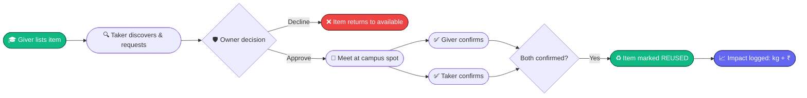
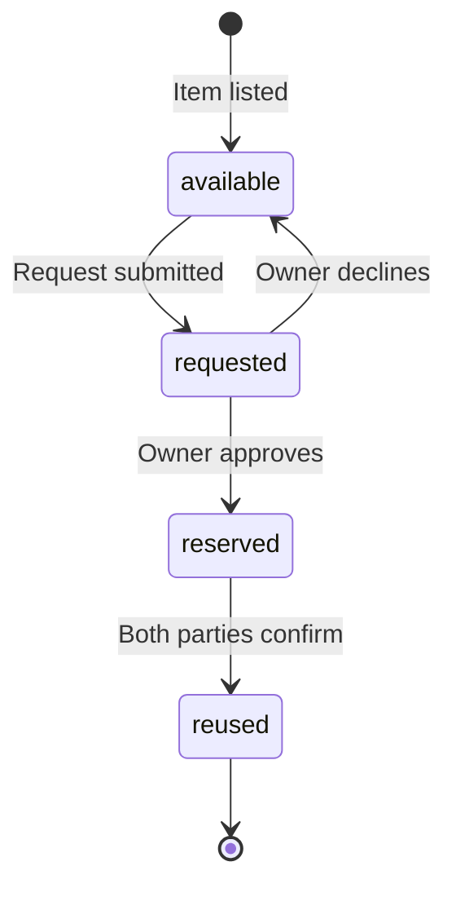
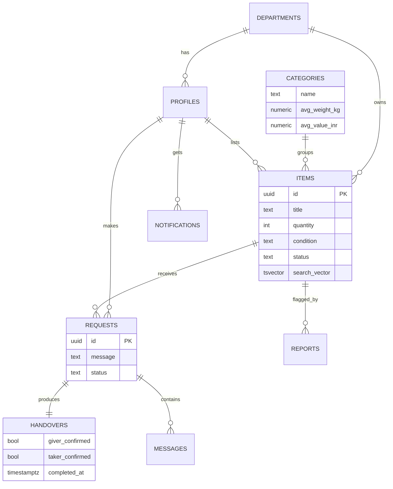

<div align="center">


<a href="https://github.com/YOUR_USERNAME/reusehub">
  
</a>

<br/>



<br/><br/>


<br/><br/>

<a href="#live-demo"> <b>Live Demo</b></a> &nbsp;•&nbsp;
<a href="#key-features"> <b>Features</b></a> &nbsp;•&nbsp;
<a href="#quick-start"> <b>Quick Start</b></a> &nbsp;•&nbsp;
<a href="#architecture"> <b>Architecture</b></a> &nbsp;•&nbsp;
<a href="#deployment"> <b>Deploy</b></a>

<br/><br/>


</div>

<a id="overview"></a>
##  Overview

Every semester, thousands of textbooks, microcontrollers, scientific calculators, drawing boards, and dorm supplies are abandoned on campuses across the country. **ReUseHub** turns that waste into a verified, student-run circular economy.

<table>
<tr>
<td width="25%" align="center">
<br/>
<b>Zero Money</b><br/>
<sub>100% free peer-to-peer sharing. No payments, ever.</sub>
</td>
<td width="25%" align="center">
<br/>
<b>Verified Campus</b><br/>
<sub>Institutional email allow-listing blocks outsiders.</sub>
</td>
<td width="25%" align="center">
<br/>
<b>Dual Handover</b><br/>
<sub>Giver and taker both confirm at a known campus spot.</sub>
</td>
<td width="25%" align="center">
<br/>
<b>Live Impact</b><br/>
<sub>Landfill kg avoided and INR saved, tracked in real time.</sub>
</td>
</tr>
</table>

<br/>

<div align="center">

###  Impact at a Glance


<br/><br/>


</div>

<a id="live-demo"></a>
##  Live Demo

> **No backend required.** Leave `VITE_SUPABASE_URL` empty and ReUseHub boots in **Instant Demo Mode** with 30 seeded items, 8 departments, 6 categories, and 3 one-click demo accounts.

| | |
| :--- | :--- |
| 🌐 **Live site** | `https://your-reusehub.vercel.app` |
| 🎬 **Demo login** | Click any demo account on the login modal |
| 📱 **Install as app** | Open on mobile → *Add to Home Screen* |

<div align="center">

</div>

<a id="key-features"></a>
##  Key Features

<div align="center">

</div>

<details open>
<summary> <b>Material Listings & Discovery</b></summary>
<br/>

- **Multi-step listing flow**: title, description, category, department, condition (`New` · `Like New` · `Good` · `Fair`), quantity, and safe campus pickup spot.
- **Client-side image compression** with instant preview.
- **Live search and filters**: instant full-text search, department filters, and category chips.
- **Rich item pages**: photo gallery, condition tags, verified-owner badge, one-click request.

</details>

<details open>
<summary> <b>Request & Handover Protocol</b></summary>
<br/>

- **Request flow** with an intended-use message from requester to owner.
- **Owner governance**: approve or decline, with automatic item status updates.
- **Interactive handover stepper** from request to meetup.
- **Dual confirmation**: when both parties confirm, the item becomes `reused` and impact metrics are logged.
- **Realtime per-request chat**: instant message exchange between giver and taker with quick meetup suggestion chips.
- **QR code handover verification**: generate and scan tamper-proof QR tokens at campus meeting spots with celebratory confetti.
- **Campus wishlist alerts**: set keyword alerts (e.g. *Arduino*, *Scientific Calculator*) and receive automatic notifications when matching items are listed.

</details>

<details open>
<summary> <b>Campus Sustainability & Impact</b></summary>
<br/>

- **Live impact ticker**: items given a second life, kilograms diverted, INR saved.
- **Department leaderboard** ranking circularity across colleges and departments.
- **Circularity badges**: unlock *Zero Waste Pioneer*, *Verified Member*, *Eco Champion*, *Campus Benefactor*, and *Super Recirculator*.
- **Admin console** with moderation tools, item removal, and CSV export.

</details>

<details open>
<summary> <b>Design & Experience</b></summary>
<br/>

- Design language inspired by **Linear, Airbnb, and Notion**: clean, airy, trustworthy.
- **Responsive shell**: frosted-glass sticky navbar on desktop, thumb-friendly bottom nav on mobile.
- **Bilingual toggle**: instant switch between **English** and **हिन्दी (Hindi)**.
- **Dark mode**: light theme and a deep forest/slate dark theme with no-flash script.
- **Installable PWA** with offline shell, manifest, and service-worker precaching.
- **Sub-300ms micro-interactions** powered by Framer Motion.

</details>

<div align="center">

</div>

<a id="how-it-works"></a>
##  How It Works

<div align="center">

</div>

<br/>



### Item Lifecycle



<div align="center">

</div>

<a id="tech-stack"></a>
##  Tech Stack

| Layer | Technologies |
| :--- | :--- |
| **Frontend** |    |
| **Styling** |  Lucide React · Plus Jakarta Sans · Inter |
| **State & Data** | TanStack Query v5 · React Context API |
| **Forms** | React Hook Form · Zod |
| **Animation** |  |
| **Backend** |  PostgreSQL 15 · Row Level Security · Auth · Storage |
| **Charts** | Recharts |
| **PWA** | `vite-plugin-pwa` · `workbox-precaching` |
| **Testing** | Vitest · React Testing Library · jsdom |

---

##  User Roles & Security

| Role | Permissions |
| :--- | :--- |
| 🎓 **Student** | Browse, list materials, request items, confirm handovers, earn circularity badges. |
| 🔬 **Faculty / Staff** | Request and donate lab equipment, surplus textbooks, components, and departmental resources. |
| 🛡️ **Admin** | Governance console, listing moderation, user management, CSV impact export. |

> 🔒 **Row Level Security** is enforced at the Postgres level: users can only modify their own listings and requests.
> 🏫 **Domain gate** via `VITE_COLLEGE_ALLOWED_DOMAINS` prevents external signups.

<div align="center">

</div>

<a id="quick-start"></a>
##  Quick Start

<div align="center">

</div>

### Prerequisites

- **Node.js** `v18+` (Node 20 LTS recommended)
- **npm** or **pnpm**

### Install & Run

```bash
# 1. Enter the project
cd reusehub

# 2. Install dependencies
npm install

# 3. Create your env file
cp .env.example .env

# 4. Start the dev server
npm run dev
```

Open **http://localhost:5173** 🎉

### Production Build & PWA Test

```bash
npm run build
npm run preview
```

### Environment Variables

```env
# Supabase credentials (leave blank for local demo mode)
VITE_SUPABASE_URL=
VITE_SUPABASE_ANON_KEY=

# College configuration
VITE_COLLEGE_NAME="Apex Institute of Technology & Sciences"
VITE_COLLEGE_ALLOWED_DOMAINS="apex.edu,campus.edu,college.ac.in,student.apex.edu"

# Enable fast 1-click demo logins
VITE_ENABLE_DEMO_ACCOUNTS=true
```

> 💡 **Instant Demo Mode:** with an empty `VITE_SUPABASE_URL`, ReUseHub activates a built-in reactive store. Everything works out of the box with zero external dependencies.

### Connecting a Real Supabase Project

1. Create a project in the [Supabase Dashboard](https://supabase.com/dashboard).
2. Open **SQL Editor** and run `supabase/migrations/20240101000000_init_schema.sql`.
3. Run `supabase/seed.sql`.
4. Copy the **Project URL** and **anon public key** from *Settings → API* into `.env`.

---

##  Built-In Demo Accounts

One-click login from the login modal and nav menu:

| Account | Name | Role | Department | Best For |
| :--- | :--- | :--- | :--- | :--- |
| 🎓 **Student** | Priya Sharma | `student` | Computer Science & Engg | **Giver**: has active listings (CLRS book, Raspberry Pi, monitor) and incoming requests to approve. |
| 🔬 **Faculty** | Dr. Aris Thorne | `faculty` | Physics & Material Sciences | **Taker**: requests lab components for student projects. |
| 🛡️ **Admin** | Rajesh Verma | `admin` | Sustainability Office | **Governance**: admin console, moderation queue, CSV export. |

<div align="center">

</div>

<a id="architecture"></a>
##  Architecture

<details>
<summary><b>📁 Project structure (click to expand)</b></summary>

```
reusehub/
├── public/                     # Static assets & SVG favicon
├── src/
│   ├── features/               # Feature-based domain modules
│   │   ├── auth/               # AuthContext, AuthModal, RoleBadge, hooks
│   │   ├── items/              # Discovery, cards, grids, forms
│   │   ├── requests/           # Handover stepper, request workflows
│   │   ├── impact/             # Impact cards and charts
│   │   └── admin/              # Moderation table, CSV exporter
│   ├── shared/
│   │   ├── ui/                 # Button, Input, Select, Badge, Card, Dialog, Tabs, Toast
│   │   └── layout/             # Navbar, BottomNav, Footer, AppShell
│   ├── lib/
│   │   ├── supabase.ts         # Supabase client
│   │   ├── mockData.ts         # Seed data (30 items, 8 depts, 6 cats)
│   │   ├── mockStore.ts        # Reactive local store with CRUD & impact math
│   │   └── utils.ts            # INR, kg, relative-time helpers
│   ├── pages/                  # Home, Browse, ItemDetail, AddItem, MyListings,
│   │                           # MyRequests, Impact, Admin, Profile, NotFound
│   ├── types/index.ts          # Strict TypeScript interfaces
│   ├── sw.ts                   # Service worker (PWA precaching)
│   ├── App.tsx                 # Routes & QueryClient
│   ├── main.tsx                # React root & theme init
│   └── index.css               # Design tokens & glass utilities
├── supabase/
│   ├── migrations/20240101000000_init_schema.sql   # DDL, RLS, FTS, triggers
│   └── seed.sql                # Categories, departments, demo users, items
├── assets/                     # Animated README SVGs
├── .github/workflows/snake.yml # Contribution snake generator
├── .env.example
├── tailwind.config.js
├── vite.config.ts
└── package.json
```

</details>

### 🗄️ Database Schema



| Table | Purpose |
| :--- | :--- |
| `departments` | Campus departments with building locations and codes |
| `categories` | Material groups with calibrated `avg_weight_kg` and `avg_value_inr` |
| `profiles` | Extends `auth.users` with college domain, roll number, role |
| `items` | Listings with auto-updated `tsvector` full-text search |
| `requests` | Peer requests: `pending` → `accepted` → `completed` |
| `handovers` | Dual-party handshake (`giver_confirmed`, `taker_confirmed`, `completed_at`) |
| `notifications` | Alerts with unread badge tracking |
| `messages` | Contextual chat per request |
| `reports` | Moderation reports for administrators |

### ⚙️ Handover Completion Trigger

When both `giver_confirmed` and `taker_confirmed` become `true`, a PostgreSQL trigger automatically:

1. Sets `completed_at = now()`
2. Sets `requests.status = 'completed'`
3. Sets `items.status = 'reused'`
4. Sends completion notifications to both parties

<div align="center">

</div>

<a id="impact-math"></a>
##  Environmental & Economic Calculations

Every completed reuse logs measurable savings:

$$\text{Landfill Waste Avoided (kg)} = \sum (\text{item.quantity} \times \text{category.avg\_weight\_kg})$$

$$\text{Student INR Saved} = \sum (\text{item.quantity} \times \text{category.avg\_value\_inr})$$

### Calibrated Category Benchmarks

<div align="center">

</div>

<br/>

| Category | ⚖️ Avg Weight | 💰 Avg Value |
| :--- | :---: | :---: |
| 📚 Books & Textbooks | 1.2 kg | ₹850 |
| 🔧 Lab & Project Hardware | 0.85 kg | ₹1,400 |
| ✏️ Stationery & Art Supplies | 0.4 kg | ₹450 |
| 💻 Electronics & Peripherals | 2.1 kg | ₹2,200 |
| 🛏️ Dorm & Campus Furniture | 4.8 kg | ₹1,800 |
| ⚽ Sports & Miscellaneous | 1.6 kg | ₹950 |

<div align="center">

</div>

<a id="deployment"></a>
##  Deployment

### ▲ Vercel (Frontend)

1. Push your repo to GitHub or GitLab.
2. Import it at [vercel.com/new](https://vercel.com/new).
3. Configure:
   - **Framework Preset:** `Vite`
   - **Build Command:** `npm run build`
   - **Output Directory:** `dist`
4. Add environment variables:
   - `VITE_SUPABASE_URL`
   - `VITE_SUPABASE_ANON_KEY`
   - `VITE_COLLEGE_NAME`
   - `VITE_COLLEGE_ALLOWED_DOMAINS`
5. Click **Deploy** 🎉

### ⚡ Supabase (Backend)

1. Create a project at [supabase.com](https://supabase.com).
2. Run `supabase/migrations/20240101000000_init_schema.sql` in the SQL Editor.
3. Run `supabase/seed.sql` to populate sample data.
4. Under **Authentication → URL Configuration**, set your production Vercel URL as the **Site URL**.

---

##  Roadmap & Features

- [x] Listings, requests, dual-confirmation handovers
- [x] Impact tracking and department leaderboard
- [x] Admin console with CSV export
- [x] Installable PWA with offline shell & service worker
- [x] Realtime chat per request with coordination quick chips
- [x] QR code generation and quick campus handover verification
- [x] Wishlist keyword alerts with automated matching & notifications
- [x] Bilingual English & Hindi (हिन्दी) localization toggle
- [x] Circularity badges & personal sustainability accounting
- [ ] Push notifications for native OS integration
- [ ] Multi-campus consortium federation

<div align="center">

</div>

##  Contribution Snake

<div align="center">

<picture>
  <source media="(prefers-color-scheme: dark)" srcset="https://raw.githubusercontent.com/YOUR_USERNAME/reusehub/output/github-snake-dark.svg"/>
  <source media="(prefers-color-scheme: light)" srcset="https://raw.githubusercontent.com/YOUR_USERNAME/reusehub/output/github-snake.svg"/>
  
</picture>

<sub>Generated automatically by <code>.github/workflows/snake.yml</code>. Run the workflow once to create the <code>output</code> branch.</sub>

</div>

---

##  Contributing

Contributions are welcome!

```bash
git checkout -b feature/amazing-idea
git commit -m "feat: add amazing idea"
git push origin feature/amazing-idea
```

Then open a Pull Request. Please run `npm run test` before submitting.

---

##  License

Distributed under the **MIT License**. See [`LICENSE`](LICENSE) for details.

---

<div align="center">

<a href="https://github.com/YOUR_USERNAME/reusehub">
  
</a>

<br/><br/>

<a href="https://star-history.com/#YOUR_USERNAME/reusehub&Date">
  
</a>

<br/><br/>


<br/>

 **If ReUseHub helps your campus, give it a star!** 


</div>
# ReUseHub

